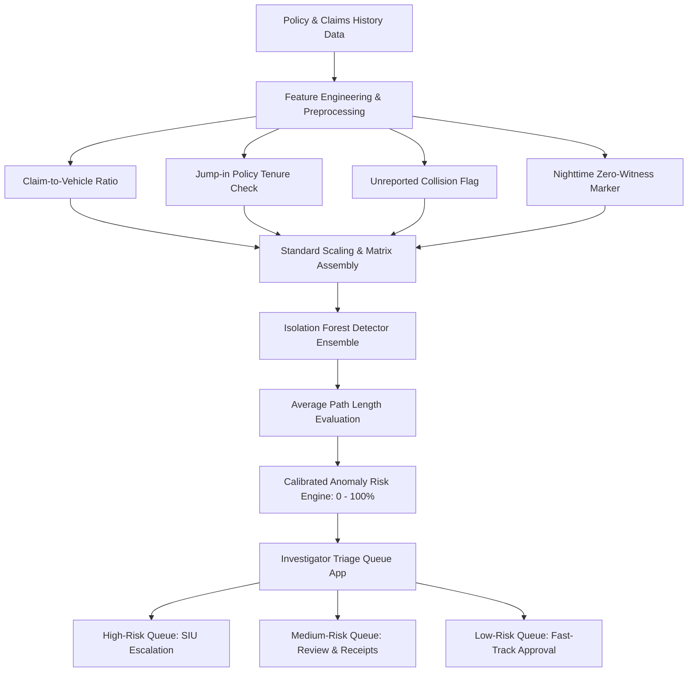

# PROJECT SYNOPSIS

**Project Title:** An Isolation Forest Anomaly Detector-Based Approach to Insurance Claim Fraud  
**Student Name:** BOBBURI PRAVEEN KUMAR  
**Guide / Supervisor:** Dr. P. Neeraja  
**Domain:** Machine Learning & Predictive Analytics  
**Academic Year:** 2025–2026  

---

## 1. Abstract
This project proposes an Isolation Forest anomaly detector to surface suspicious motor-insurance claims, addressing the problem of insurance claim fraud through a data-driven approach. The pipeline draws on policy and claims history data, applying suitable pre-processing before training and testing the model on held-out data. The project culminates in an investigator triage queue, bridging the gap between the underlying model and everyday use.

## 2. Problem Statement
Motor vehicle insurance fraud accounts for tens of billions of dollars in annual global losses. Traditional fraud mitigation approaches rely heavily on:
1. **Manual Audits / Random Sampling:** Highly inefficient, costly, and fails to identify subtle coordinated schemes.
2. **Rule-Based Thresholds:** Rigid static if-else checks (e.g. claim > \$10,000) that are easily bypassed once fraudsters discover rules.
3. **Supervised Classification Models:** Vulnerable to severe class imbalance (frauds typically represent < 5–10% of total volume) and fail when confronted with previously unseen, novel fraud typologies (zero-day fraud patterns).

There is a critical requirement for an **unsupervised, robust anomaly detection pipeline** that flags outliers based on statistical tree isolation properties, coupled with an actionable, risk-ranked **Investigator Triage Queue**.

## 3. Existing System vs Proposed System

| Dimension | Existing System | Proposed Isolation Forest System |
| :--- | :--- | :--- |
| **Learning Paradigm** | Supervised classifiers (Logistic Regression, Random Forest) or manual heuristics | **Unsupervised Anomaly Detection** via recursive tree partitioning |
| **Sensitivity to Imbalance** | Struggles drastically with severe class imbalance (e.g., 90:10 / 95:5 ratios) | **Immune to class imbalance**; specifically models anomalies as "few and different" |
| **Adaptability** | Flags only known historical patterns recorded in training labels | Can catch **novel, unseen fraud patterns** because it isolates anomalous outliers |
| **Operational Usability** | Raw binary labels (0/1) without priority or explanation | **Calibrated 0–100% Risk Scores**, **Priority Tiers (High/Med/Low)**, and **Feature Attribution** |
| **End-User Interface** | Batch CSV or terminal scripts | **Interactive Streamlit Web Dashboard** with real-time inspector queue and simulator |

## 4. Key Objectives
1. **Dataset Synthesis & Ingestion:** Ingest multi-attribute motor insurance records covering policy tenure, customer demographics, accident telemetry (hour, severity, vehicle count), witness logs, and sub-claims.
2. **Domain-Specific Feature Engineering:** Formulate behavioral metrics such as claim-to-vehicle-value ratio, jump-in policy tenure flag, unwitnessed late-night collision indicator, and bodily injury claim disparity.
3. **Isolation Forest Model Construction:** Train an ensemble of Isolation Trees ($t = 200$) to isolate anomalous points based on BST path length $h(x)$.
4. **Scoring Calibration & Feature Explainability:** Translate raw isolation path lengths into an intuitive 0.0% to 100.0% fraud risk rating and compute feature deviation z-scores.
5. **Investigator Triage Queue:** Construct a high-throughput operational dashboard enabling insurance adjusters to triage high-risk claims, view root cause explanations, and simulate new claims.

## 5. System Architecture

## 6. Hardware & Software Requirements
- **Operating System:** Windows 10/11, Linux, or macOS
- **Programming Language:** Python 3.10+ / 3.12
- **Core ML & Math Libraries:** `scikit-learn`, `pandas`, `numpy`, `joblib`
- **Visualization & UI Framework:** `streamlit`, `matplotlib`
- **Target Hardware:** Standard PC / Laptop (4GB+ RAM, Multi-core CPU)
